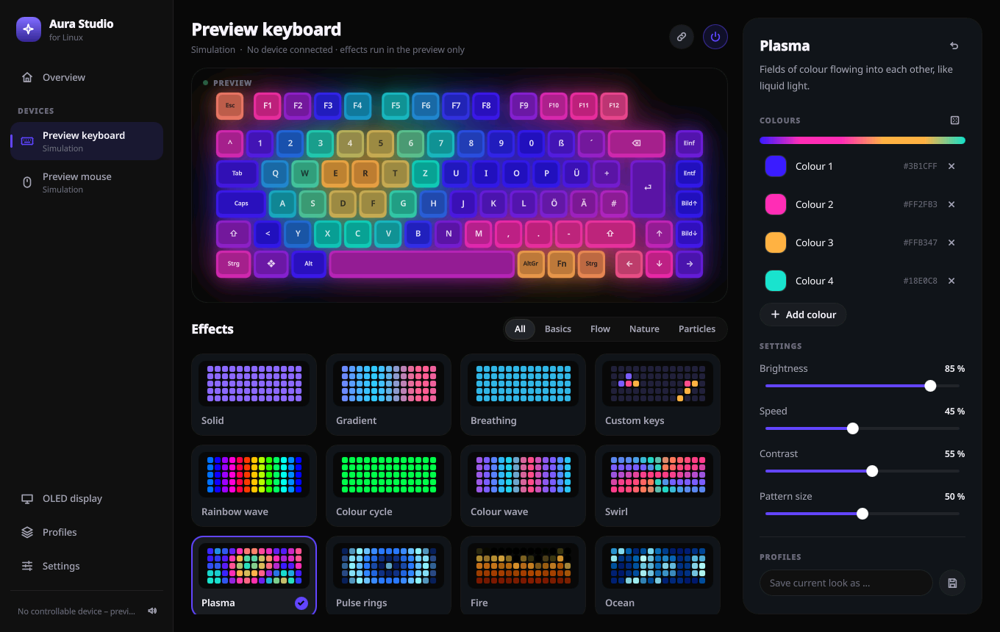
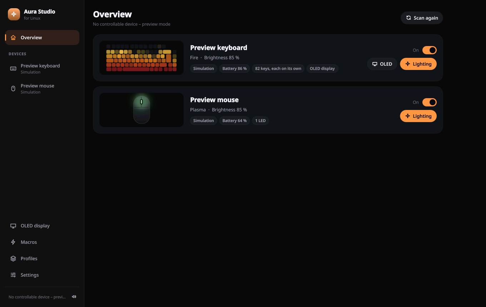
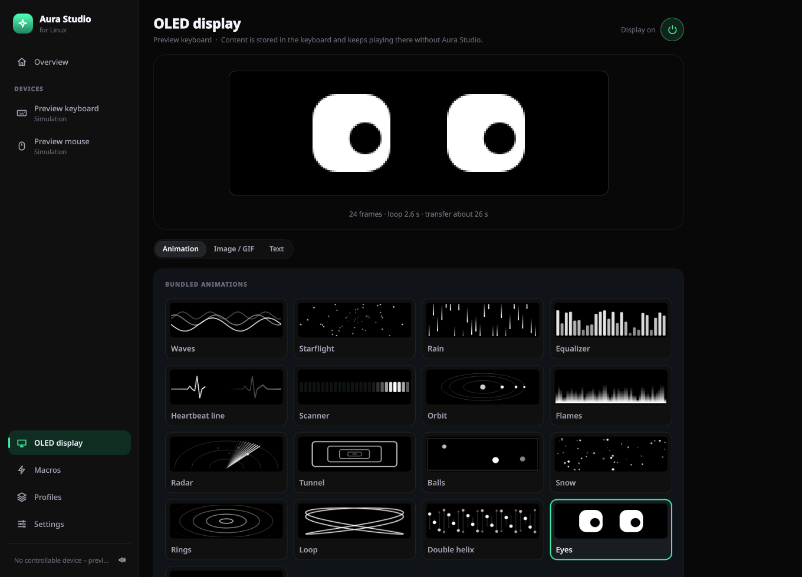
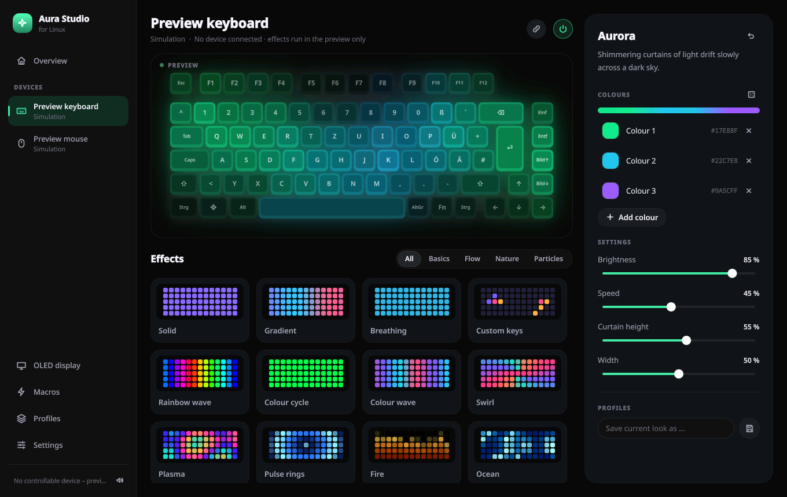
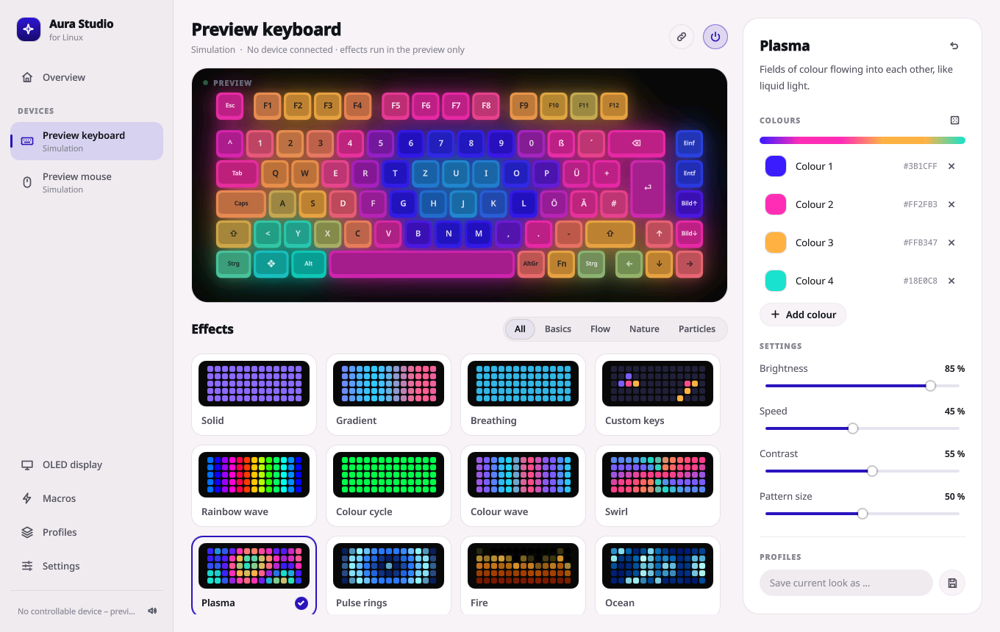

# Aura Studio

**An open-source Armoury Crate alternative for Linux.** Per-key RGB effects and OLED control for ASUS ROG peripherals, with a native Qt interface and no vendor software, daemon or OpenRGB required.



> Aura Studio is an independent community project. It is not affiliated with or endorsed by ASUS. ASUS, ROG, Aura and Armoury Crate are trademarks of their respective owners.

## What it does

- **Per-key lighting.** 20 effects that are computed for every key from its physical position: fire that burns upwards from the bottom row, thunderstorm, aurora, matrix rain, raindrops, comet, plasma, lava and more. Each effect has its own colours and controls (speed, direction, pattern size, flame height …), and every change shows on the device immediately.
- **Custom keys.** Paint individual keys right in the live preview, with quick selections for WASD, arrows, numbers and so on.
- **OLED display (ROG Azoth).** Send images, GIFs, static or scrolling text and 17 bundled animations to the keyboard's display, switch to the six factory animations, show a live clock, and turn the display on or off. Uploaded content is stored in the keyboard and keeps playing without the app.
- **Macros.** Trigger a sequence of keys, mouse clicks, typed text and pauses from any key, mouse button or combination on your ROG devices: once, while held, or toggled. Steps can be recorded or edited by hand.
- **Profiles.** Save lighting setups, see them as thumbnails and apply them with one click.
- **Overview.** All controllable devices on one page, with the running effect, battery level and a power switch each.
- **Battery warnings.** A desktop notification when keyboard or mouse run low, with an adjustable threshold.
- **Made to be pleasant.** Live preview of keyboard and mouse, light and dark theme, an accent colour that follows the running effect or one you pick, soft interface sounds, optional system tray mode and start at login.
- **English and German**, following the system language or set by hand.

| Overview | OLED display |
| --- | --- |
|  |  |

| Aurora effect | Light theme |
| --- | --- |
|  |  |

The screenshots show the built-in simulated devices.

## Supported hardware

| Device | Connection | Lighting | OLED |
| --- | --- | --- | --- |
| ROG Azoth | ROG Omni Receiver (2.4 GHz) | per key, **tested** | **tested** |
| ROG Azoth | USB cable, own 2.4 GHz dongle | per key, implemented but untested | implemented but untested |
| ROG Harpe Ace Extreme | ROG Omni Receiver | scroll wheel LED (HID LampArray), **tested** | – |

Other ASUS HID devices are detected and listed but cannot be controlled yet. Features Armoury Crate has and Aura Studio does not: key remapping, macros stored in the device, mouse DPI and polling settings, firmware updates, the OLED system monitor and music visualiser.

Developed and tested on Fedora with KDE Plasma (Wayland). It should run on any current Linux desktop with Python 3.10+ and Qt 6.

## Install

```bash
git clone https://github.com/stxfnnn/aura-studio.git
cd aura-studio
bash packaging/install-user.sh
```

The script creates a virtual environment inside the project folder, installs Aura Studio into it and adds a launcher to your application menu. Start it from the menu or with `.venv/bin/aura-studio`.

Your user needs access to the devices' `hidraw` nodes. Install the bundled udev rule once:

```bash
sudo cp packaging/99-aura-studio.rules /etc/udev/rules.d/
sudo udevadm control --reload && sudo udevadm trigger
```

To try the interface without any hardware, run `AURA_STUDIO_DEMO=only .venv/bin/aura-studio`; it starts with a simulated keyboard and mouse and touches no device.

## Good to know

- **Effects are rendered by the app.** They run while Aura Studio is open (optionally in the system tray). On quit the keyboard is handed to its closest built-in firmware effect and the mouse returns to its own lighting.
- **OLED uploads take a while.** The keyboard acknowledges every packet, which comes to roughly one second per frame over the wireless receiver. Key lighting pauses during a transfer.
- **OLED brightness** is baked into the uploaded content; the factory animations and the live clock are not affected by it.
- **Macros run in software.** Triggers are read from the devices' HID reports and played back through a virtual input device (`/dev/uinput` must be writable for your user). The trigger key keeps its normal function, and macros only work while Aura Studio is running. Key presses are matched in memory and never logged.
- Settings, profiles and macros live in `~/.config/aura-studio/`, the diagnostic log in `~/.local/state/aura-studio/`. Serial numbers are never logged.

## A word of caution

ASUS does not document these protocols. Lighting uses the Aura TUF keyboard protocol and standard HID LampArray reports. The OLED support is based on community reverse engineering and writes to the keyboard's flash memory, so use it at your own risk. Aura Studio only commits an upload after the keyboard has acknowledged every single packet.

If the OLED ever misbehaves:

- **Display stays dark, no logo when the keyboard powers on:** it is probably switched off in the keyboard (for example from Armoury Crate earlier). Use the power button at the top of the OLED page.
- **Display stays black after an aborted transfer:** switch the keyboard off and on again.
- **Display restarts in a loop:** pick one of the factory animations on the OLED page, several times if needed.

## How it is built

| Path | Purpose |
| --- | --- |
| `src/aura_studio/devices.py` | device discovery through sysfs |
| `src/aura_studio/hid.py` | hidraw transport: per-key frames, LampArray, battery query |
| `src/aura_studio/layout.py` | key positions and LED ids of the ROG Azoth |
| `src/aura_studio/effects.py` | effect catalogue and per-key colour maths |
| `src/aura_studio/engine.py` | one render thread per device |
| `src/aura_studio/oled.py`, `oled_controller.py` | OLED rendering, animations and upload protocol |
| `src/aura_studio/macros.py` | macro triggers (hidraw), playback (uinput) and the macro editor's backend |
| `src/aura_studio/service.py` | bridge to the interface, saved state, profiles, battery warnings |
| `src/aura_studio/i18n.py` | translations (source strings are German) |
| `src/aura_studio/qml/` | the interface |
| `tools/make_sounds.py` | regenerates the synthesised interface sounds |
| `tools/check_translations.py` | verifies every interface string has a translation |

Pure Python with PySide6 as the only dependency.

## How it was made

Aura Studio is, among other things, vibe coded: large parts were written with AI coding assistants (it started with ChatGPT and was rebuilt with Claude Code) and directed, tested on real hardware and steered by a human. Read the code with that in mind, and expect rough edges on hardware it has not been tested with.

## Credits

The OLED protocol builds on the reverse-engineering work published in [Timeroot/azoth-nn](https://github.com/Timeroot/azoth-nn) and [IcyBlue17/ROG-AzothOLED-HIDProtocol](https://github.com/IcyBlue17/ROG-AzothOLED-HIDProtocol). The Aura TUF lighting protocol is known from the [OpenRGB](https://openrgb.org) project.

## License

MIT, see [LICENSE](LICENSE).
